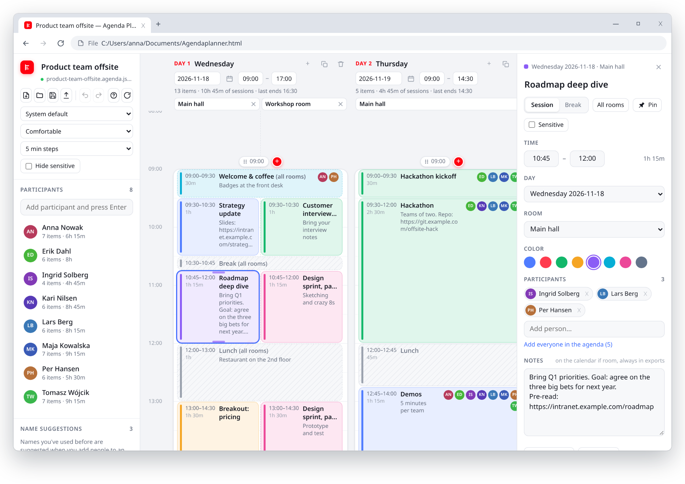
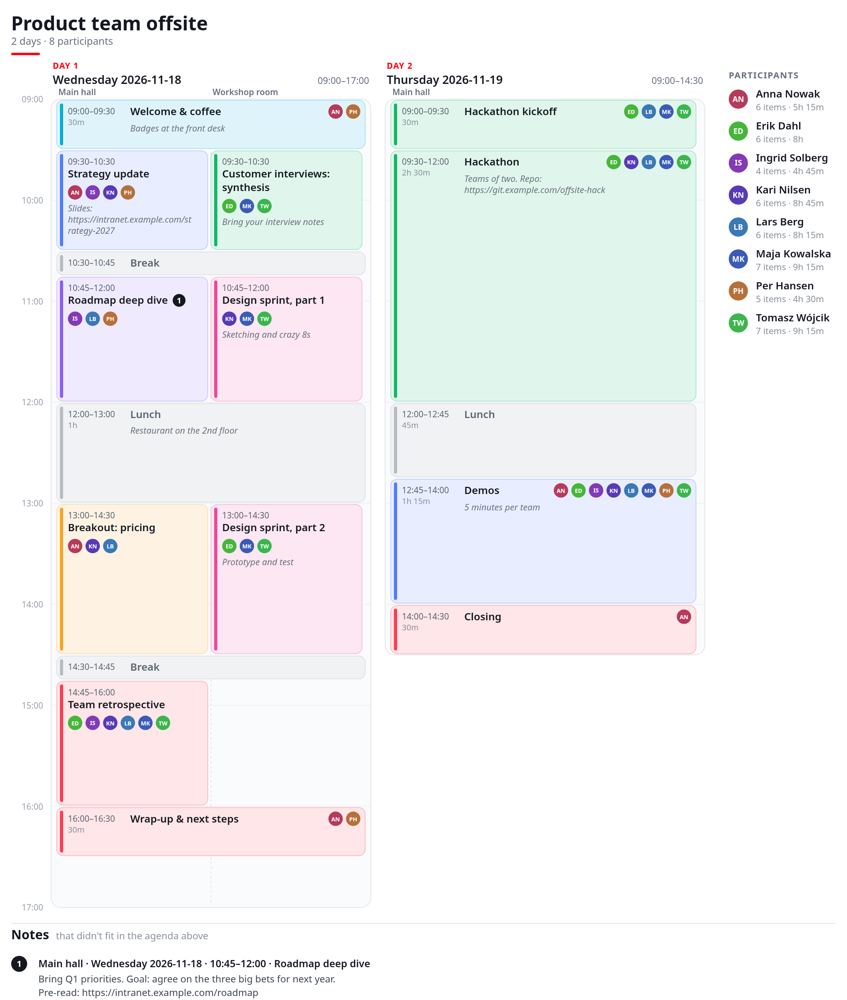
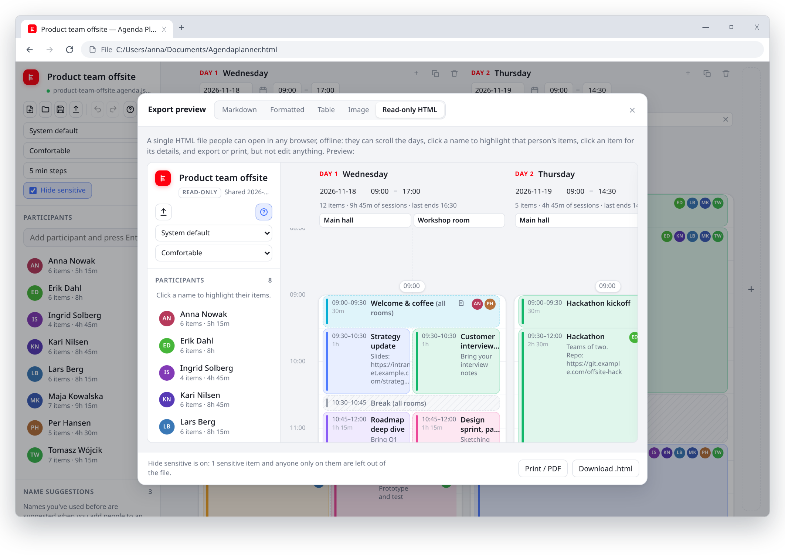
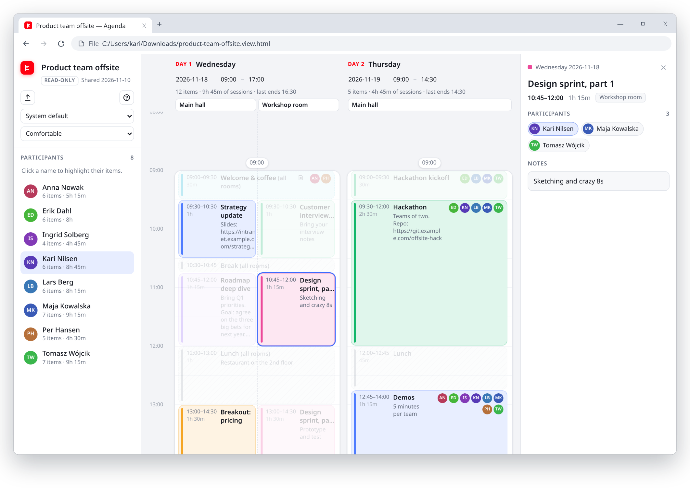

# Agenda Planner

A visual planner for multi-day agendas with **parallel rooms** — built as a **single HTML file** that saves to a **single JSON file**. No server, no build step, no dependencies, works fully offline.



## Quick start

1. Open **`Agendaplanner.html`** in Edge or Chrome (double-click the file — no installation needed).
2. Plan your agenda on the board: add days, items, participants.
3. Press **Ctrl+S** to save. The agenda is stored as **one `.agenda.json` file** — in Edge/Chrome it saves straight to a file and folder you pick; other browsers download a copy. Re-open any agenda with **Ctrl+O** or by dropping the JSON file onto the window.
4. To share it, press **Ctrl+E** and pick **Read-only HTML**: you get one `.view.html` file that anyone can open in their browser to browse the agenda (see [Sharing a read-only copy](#sharing-a-read-only-copy)).

Everything else — the unsaved draft, known participant names, theme and zoom — lives in your browser's `localStorage`. Your agenda data is never sent anywhere.

## The whole app is one file, the agenda is one file

| What | File | Notes |
|---|---|---|
| The application | `Agendaplanner.html` | HTML + CSS + JS, zero dependencies, ~150 KB |
| A shared read-only copy | `*.view.html` | The app in viewer mode with one agenda built in; opens in any browser |
| Each agenda | `*.agenda.json` | Human-readable JSON, easy to diff, version-control or generate |

Because an agenda is a single JSON document, you can keep agendas in git, generate them from scripts, or share them as one attachment.

## Features

- **Days** — one or more days per agenda, each with its own date and start/end time; duplicate or delete days.
- **Rooms (multi-room days)** — split a day into parallel tracks ("Main hall", "Workshop room", …). Add rooms with the `+` on the day header, rename them inline, drag items sideways to move them between rooms or days.
- **All-rooms items** — the *All rooms* toggle in the editor stretches an item across every room (team dinner, Teams call available in all rooms). Rendered full-width with a dashed border.
- **Overbooking flags** — if a person is on two overlapping items in the same day (across rooms), both items get a red outline + ⚠, the day header and participant list show an *overbooked ×n* count, and the editor names the conflict.
- **Participants** — badges on every item, per-person totals, name suggestions learned from your previous agendas.
- **Direct manipulation** — drag item edges to resize (touching items stay glued), drag the body to move, drag further to unglue and reorder, double-click empty time to insert, pin items so edits never move them.
- **Breaks, colors, notes** — session/break types, per-item colors, notes shown on the board and in exports.
- **Sensitive items** — tick *Sensitive* in the item editor to mark an item. The *Hide sensitive* toggle in the sidebar then hides all sensitive items, and people who appear only on them, on the board and in every export (Markdown, formatted HTML, table, PNG image, read-only HTML, print). The saved `.agenda.json` still contains them.
- **Exports** — preview, then copy or download as **Markdown**, **formatted HTML** (paste into Outlook/Teams/Word), a **table** (one per day; pastes as real cells into Excel/Word/Outlook, with a Room column on multi-room days), or a **PNG image** of the whole agenda (rooms shown as sub-columns, like the board). Print/PDF works too.
- **Read-only HTML (share it)** — a single `.view.html` file that anyone can open in a browser to browse the agenda without being able to change it. See [Sharing a read-only copy](#sharing-a-read-only-copy).
- **Undo/redo** (Ctrl+Z / Ctrl+Y), zoom and snap-step controls, 9 color themes (auto dark/light + Solarized, Nord, Gruvbox, Dracula).
- **Self-update** — once a day (or via the ↻ toolbar button) the app checks GitHub for a newer release. If one exists you get a prompt to download the new single-file app (you pick the folder/file to save to), then a **Reload** button to switch to it. Works offline: the check is simply skipped when there's no network.

The **Image** export: rooms as sub-columns, a participant legend, and notes that don't fit on a card listed underneath (here with *Hide sensitive* on, so the leads-only item is left out):



## Sharing a read-only copy

*New in v1.2.* Press **Ctrl+E**, open the **Read-only HTML** tab, check the live preview, and click **Download .html**. You get one `<agenda-title>.view.html` file to email, put on Teams/SharePoint or drop in a shared folder. Recipients double-click it, with nothing to install and no network needed.



What people can do in the shared copy:

- **Browse** all days and rooms, change the zoom and theme.
- **Click a name** in the participant list to highlight that person's items (everything else fades). Click again to clear. Names in an item's details highlight the same way.
- **Click an item** to see its day, time, length, room (or *All rooms*), participants and notes. Web links in notes are clickable.
- **Export or print** it themselves: Markdown, formatted HTML, table, image or another read-only copy.
- On a **phone** the participant list sits above the board, so highlighting still works.

What's gone: everything that edits (adding, dragging, resizing, the item editor, day and room controls), New/Open/Save, undo/redo and the update check. The shared copy never writes drafts or name suggestions to the viewer's browser.

**Sensitive items:** if *Hide sensitive* is on when you export, sensitive items and the people who are only on them are **removed from the file's data**, not just hidden, so they can't be dug out of the HTML source. If it's off, the export footer tells you how many sensitive items the file will include.



## Agenda file format

A minimal `.agenda.json` looks like this:

```json
{
  "app": "agenda-planner",
  "version": 1,
  "title": "Team workshop",
  "snap": 5,
  "participants": [{ "id": "p1", "name": "Anna Nowak" }],
  "days": [{
    "id": "d1",
    "date": "2030-03-10",
    "start": 540,
    "end": 1020,
    "rooms": [{ "id": "r1", "name": "Main hall" }, { "id": "r2", "name": "Workshop room" }],
    "items": [
      { "id": "i1", "title": "Welcome", "start": 540, "end": 570, "room": "r1",
        "color": "#f5a524", "type": "session", "participants": ["p1"], "notes": "", "pinned": false, "spanAll": false, "sensitive": false }
    ]
  }]
}
```

Times are minutes after midnight (`540` = 09:00). `spanAll: true` stretches an item across all rooms of its day. Files saved by older versions without `rooms` load fine — they get a single default room.

## Shortcuts

| Keys | Action |
|---|---|
| `Ctrl+S` / `Ctrl+Shift+S` | Save / Save as |
| `Ctrl+O` | Open agenda file |
| `Ctrl+E` | Export preview (incl. read-only HTML for sharing) |
| `Ctrl+Z` / `Ctrl+Y` | Undo / redo |
| `Ctrl+D` | Duplicate selected item |
| `P` / `Del` | Pin / delete selected item |
| `↑` / `↓` in a time field | Step by the snap interval |
| `?` | Show/hide the help panel |
| `Esc` | Deselect / close dialogs |

## Privacy

The app runs entirely in your browser: no accounts, no analytics. The only network calls are the update check and download, which go to GitHub and carry none of your data. Agendas live in the JSON files you save; drafts and name suggestions in `localStorage`.

## License

[MIT](LICENSE) — use it, modify it, share it freely; just keep the copyright notice.
